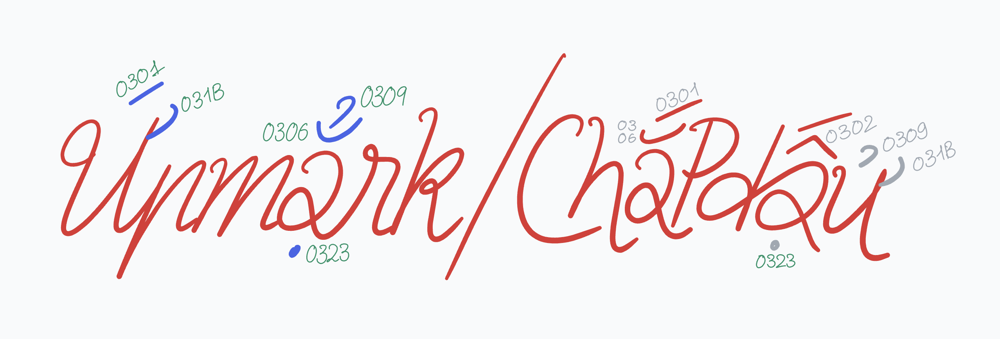

# Ứpmẳrk/ChắpDấu
Upmark/Chắp dấu - A secret project of mine on adding Vietnamese support to unsupported typefaces on Google Fonts and GitHub (with OFL 1.1)

## Introduction
- Hi there, I'm Kiên. And I manage this project of **adding Vietnamese diacritic marks to typefaces that doesn't contain Vietnamese characters in their typefaces**
- There are lots of typefaces on Google Fonts and GitHub that supports Vietnamese nowaday, but some of them doesn't come with Vietnamese support. In Vietnam, if there is an unsupported typeface, we will ask for the *"Việt Hóa"* version of it, which is a Vietnam-included version of that typeface. I don't know since when we have this but if there is any fonts that doesn't support Vietnamese, some of us either, adding Vietnamese to it ourselves or asking if there is any *"Việt Hóa"* version. 
- Since Google Fonts existed, there has been lots of typefaces supporting Vietnamese, but enough is never enough, there will still be many typefaces that we like but don't support the language. *That's disturbing, annoying and sad of course, when a font family we love so much but not for our language*.
- Yes, there are some people using AI to create a tool to add the Vietnamese, but it's not always perfect.

## About the project
- So I'm here, as a Vietnamese-Vietnamese uni student, trying to add Vietnamese diacritic marks MANUALLY to every typefaces that I can find on Google Fonts or GitHub.
- This is how it works, *since I don't know how to use GitHub properly yet*:
  - I will download the typefaces from Google Fonts or GitHub
  - I then try to understand how the font works and how can I add my own Vietnamese glyphs without breaking the original font file content.
  - I add the Vietnamese to it, including the missing diacritic marks, and the stacked one.
  - Add the Kerning to the new glyphs then export it as TTF files and Variable TTF files (if the typeface has that)
  - *Normally, that's it, but I want to make this more interesting*, I will create an issue for suggesting Vietnamese support, then just leave it there. Nothing more, nothing less. If they respond, I'm happy to help, if not, it's ok.

## What will be included here?
- The font files that I modified, into the repository, of course. If someone asks me to remove it, I'll be happy to do so. *(I'll have to figure how first)*
- And...well, that's it. No source Glyphs 3 or Glyphs 4 file or something, maybe the VFC (the FontLab save file) and *the license of the fonts and the link to the original*, I couldn't think of anything else I should include.

# Progress
- *Yes, I did that before creating this.*
- MARTIAN GROTESK: [Original Link](https://github.com/evilmartians/grotesk)
  - Vietnamese glyphs: ADDED (100%) - just need some more fix on the glyphs
  - Suggestion: DONE
  - Currently: Working to refine the glyphs.
- MOZILLA HEADLINE and MOZILLA TEXT: [Headline](https://github.com/mozilla/mozilla-headline-type), [Text](https://github.com/mozilla/mozilla-text-type)
  - Vietnamese glyphs: 25% - only the Uppercase for the Headline typeface
  - Suggestion: NOTHING
  - Currently: Adding glyphs
- ...*the next typeface will appear here*
